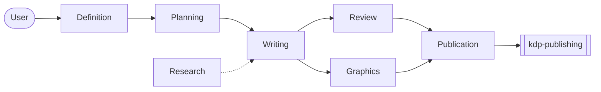

# book-writing

A Claude Code plugin for writing a full-length reference or instructional book
with teams of subagents — organised so that no single agent is ever given a task
large enough to degrade.

```
/plugin install book-writing@danielrosehill
```

## What it is for

Producing a print-on-demand paperback — Lulu, KDP Create, or equivalent — that
carries educational, instructional or reference material which did not exist in
that form before. Manuals, field guides, technical references, the documentation
of a system nobody has written down.

It is an agentic *research* pattern in which the book is the delivery mechanism.
It is deliberately not built for producing books at volume: the pipeline gates on
a definition stage a volume generator would make optional, it binds writers to
evidence they can reach, and its unit of value is one book worth printing.

## The problem it solves

One agent cannot write a book. Not because a manuscript will not fit in a context
window — increasingly it does — but because **quality degrades long before the
window fills.** A single agent carrying a whole book restates what it said
earlier, drifts in register, echoes its own chapter openings, and starts
producing text that is locally fluent and globally empty.

So the architecture is context management by delegation. Every writing task is
one chapter, from one brief.

That has a cost, and the plugin is mostly machinery for paying it: agents that do
not read each other's work cannot stay consistent by reading, so **consistency is
carried by documents instead** — a style guide, per-chapter briefs, a continuity
ledger. That trade is the whole pattern.

## The teams



| Team | Agents |
| --- | --- |
| Definition | `brief-recorder`, `spec-interviewer`, `spec-writer` |
| Planning | `voice-designer`, `outline-architect` |
| Research | `chapter-researcher` |
| Writing | `chapter-writer` × n, in parallel |
| Review | `proofreader`, `voice-auditor`, `continuity-auditor` |
| Graphics | `graphics-director`, `figure-maker` |
| Publication | assembly scripts, then handoff |

Teams hand off through the repository, not through conversation — which is what
lets a stage be re-run, resumed weeks later, or inspected without replaying the
session that produced it.

## Commands

| | |
| --- | --- |
| `/book-new` | Create the project workspace from the template |
| `/book-brief` | Record the brief exactly as given, asking nothing |
| `/book-interview` | Ask only the gaps that change the work |
| `/book-spec` | Settle the spec |
| `/book-style` | Write the style guide |
| `/book-outline` | Design the structure and write per-chapter briefs |
| `/book-research` | Gather a chapter's sources |
| `/book-draft` | Draft chapters with parallel writers |
| `/book-review` | Proofread, voice audit, continuity audit |
| `/book-graphics` | Visual language and figures |
| `/book-assemble` | Assemble and hand off to print geometry |
| `/book-status` | What is drafted, what is blocking |

## Three rules that carry most of the value

**Recording and interviewing are separate agents.** `brief-recorder` asks nothing
and interprets nothing. An agent that records and questions in one turn leads the
witness, and the user's original framing is unrecoverable once paraphrased.

**Writers never read other chapters' drafts.** Text in context is text to
imitate: a writer that has read chapter three reuses its transitions, borrows its
examples and inherits whatever drift it had already accumulated. Each brief
carries neighbour summaries as the controlled substitute.

**Two chapters drawing on the same source do not draft concurrently.** Two agents
given the same source describe it differently, and both descriptions ship.
Neither agent did anything wrong and no per-chapter reviewer will catch it.

## What it does not do

**It does not typeset your book.** Trim, gutter, spine width, cover wrap and
pre-flight belong to
[**kdp-publishing**](https://github.com/danielrosehill/KDP-Publishing-Plugin),
which builds the cover last from the interior's measured extent rather than from
an estimated page count. `/book-assemble` produces `dist/manuscript.md` and a
JSON sidecar and hands off there.

The division runs both ways: that plugin states it does not write your book, and
this one does not typeset it. Typesetting and authorship have different failure
modes, and tools that bundle them tend to be good at neither.

**It does not verify facts.** `book.py lint` checks that a source is cited, never
that it says what the chapter claims. A chapter can pass every mechanical gate
while making a confident, specific, invented claim. Someone has to read the book.

## The workspace

Each book lives in its own repository, instantiated from
[Claude-Book-Workspace-Template](https://github.com/danielrosehill/Claude-Book-Workspace-Template).
That repo is canonical; `template/` here is a byte-identical vendored copy so
`/book-new` can scaffold locally when `gh` is unavailable.

```bash
./scripts/sync-from-template.sh --check   # report drift
./scripts/sync-from-template.sh           # refresh the vendored copy
```

A workspace works standalone. `python3 scripts/book.py status | lint | assemble`
run with this plugin uninstalled, because a book outlives a plugin version.

## The pattern

Specified and documented at
[**Agentic-Book-Writing**](https://github.com/danielrosehill/Agentic-Book-Writing).
`SPEC.md` there is the source of truth; this plugin is an implementation of it and
is wrong where the two disagree.

MIT.
