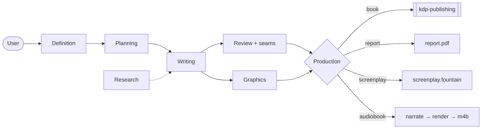

# long-form-content

A Claude Code plugin for producing long-form content with teams of subagents:
a **book**, a long-form **research report**, a **screenplay** or an
**audiobook**. It is organised so that no single agent is ever given a task large
enough to degrade.

```
/plugin install long-form-content@danielrosehill
```

Successor to `book-writing` (v1, this repo's former name). A v1 workspace
(`book.toml`, `.book-writing`) still loads; `lint` reminds you to rename it.

## One pipeline, four endings

| Type | Unit of delegation | Production stage | Ends as |
| --- | --- | --- | --- |
| `book` | chapter | assemble → body typesetting → handoff | `dist/manuscript.md` → [kdp-publishing](https://github.com/danielrosehill/KDP-Publishing-Plugin) |
| `report` | section | assemble → pandoc + typst | `dist/report.pdf` |
| `screenplay` | sequence (a run of scenes), Fountain | assemble → Fountain renderer | `dist/screenplay.fountain` / `.pdf` |
| `audiobook` | chapter | spoken script → per-chapter TTS → join, marks, tags | `dist/audiobook.m4b` |

Definition, planning, drafting and review are identical for all four. That is
the point: the hard part of long-form work is keeping a dozen independently
written units reading as one work, and that problem does not change with the
medium. `[output] type` in `longform.toml` picks the ending.

## The problem it solves

One agent cannot write a long work well. That is not because the text will not
fit in a context window (increasingly it does). It is because **quality degrades
long before the window fills.** A single agent carrying a whole book:

- restates what it said earlier
- drifts in register
- echoes its own chapter openings
- produces text that is locally fluent and globally empty

So the architecture manages context by delegation. Every writing task is one
unit, written from one brief, and writers never read each other's drafts.

Agents that do not read each other's work cannot stay consistent by reading, so
**consistency is carried by documents instead**: a style guide, per-unit
briefs, and a continuity ledger.

## Seams: where it breaks, and the agent for it

The cost of writers who never read each other is paid at the **joins**. Unit N+1
re-introduces what N just said. Both sides recap. N+1 opens from a state N never
left the reader in. In a screenplay, a character is in two places across a cut.
Whole-work continuity checks miss this, because each unit is fine on its own.

So seams get their own contract and their own reviewer:

- Every brief has a **Seams** section: *picks up from* and *hands off to*.
  Both sides of each join are written together, at outline time.
- `longform.py seams` cuts each join (the tail of N, the head of N+1, both
  briefs' Seams lines) into one small file.
- One **`seam-reviewer`** per seam, in parallel, reads only that file and
  reports edge edits addressed to one side, or to the outline.
- `lint` flags seams left unreviewed and reviews made stale by later edits.
- Audiobooks get a second seam pass on the spoken scripts, where chapter
  announcements and sign-offs are added.

## The teams



| Team | Agents |
| --- | --- |
| Definition | `brief-recorder`, `spec-interviewer`, `spec-writer` |
| Planning | `voice-designer`, `outline-architect` |
| Research | `chapter-researcher` |
| Writing | `chapter-writer` × n, in parallel |
| Review | `proofreader`, `voice-auditor`, `continuity-auditor`, `seam-reviewer` × seams |
| Graphics (book, report) | `graphics-director`, `figure-maker` |
| Audiobook production | `narration-adapter` × n, then `render` and `audio-assemble` |

Teams hand off through the repository, not through conversation. A stage can be
re-run, resumed weeks later, or inspected without replaying the session that
produced it.

## Commands

| | |
| --- | --- |
| `/lf-new` | Create the project workspace from the template |
| `/lf-brief` | Record the brief exactly as given, asking nothing |
| `/lf-interview` | Ask only the gaps that change the work |
| `/lf-spec` | Settle the spec |
| `/lf-style` | Write the style guide (and pronunciation lexicon for audio) |
| `/lf-outline` | Design the structure and write per-unit briefs, seams included |
| `/lf-research` | Gather a unit's sources |
| `/lf-draft` | Draft units with parallel writers |
| `/lf-seams` | Review the joins, one seam-reviewer per seam |
| `/lf-review` | Proofread, voice audit, continuity audit, seams |
| `/lf-graphics` | Visual language and figures (book, report) |
| `/lf-assemble` | Production: book handoff, report or screenplay PDF |
| `/lf-narrate` | Audiobook: spoken scripts, script-lint, spoken seams |
| `/lf-render` | Audiobook: per-chapter TTS, then the chaptered m4b |
| `/lf-status` | What is drafted, what is blocking |

## The audiobook chain

The manuscript stays the text of record. A `narration-adapter` per chapter
writes a spoken script beside it (`audio/script/`). Each adapter:

- normalises written forms to spoken ones (numbers, dates, symbols, units)
- removes anything visual
- applies a shared pronunciation lexicon, so a name is said the same way in
  chapter one and chapter twelve
- emits plain text or SSML, as the engine expects

`script-lint` catches what slipped through.

`render` calls one configurable shell command per chapter (`[audio] render_cmd`,
any engine). It is resumable, and never trusts a partial file.

`audio-assemble` uses ffmpeg to:

- join the chapters with gaps and an optional intro and outro
- normalise loudness
- embed chapter marks, tags and cover art

It writes `dist/audiobook.m4b` and a JSON sidecar with chapter timings.

## Rules that carry most of the value

**Recording and interviewing are separate agents.** `brief-recorder` asks nothing
and interprets nothing. The user's original framing is unrecoverable once
paraphrased.

**Writers never read other units' drafts.** Text in context is text to imitate.
Briefs carry neighbour summaries and seam lines as the controlled substitute.

**Two units drawing on the same source do not draft concurrently.** Two agents
given the same source describe it differently, and both descriptions ship.

**Joins are reviewed by an agent that sees only the join.** It is cheap and
parallel, and it catches the failure the other reviewers structurally cannot.

## What it does not do

**It does not do print geometry.** Trim, gutter, spine and cover wrap belong to
[kdp-publishing](https://github.com/danielrosehill/KDP-Publishing-Plugin).

**It does not ship a TTS engine or deliver files.** `render_cmd` is yours, and the
plugin stops at `dist/`.

**It does not verify facts.** `lint` checks that a source is cited, never that
it says what the unit claims. Someone has to read the work.

## The workspace

Each project lives in its own repository, instantiated from
[Long-Form-Content-Workspace-Template](https://github.com/danielrosehill/Long-Form-Content-Workspace-Template).
That repo is canonical. `template/` here is a byte-identical vendored copy, so
`/lf-new` can scaffold locally when `gh` is unavailable.

```bash
./scripts/sync-from-template.sh --check   # report drift
./scripts/sync-from-template.sh           # refresh the vendored copy
```

A workspace works standalone. `python3 scripts/longform.py` (standard library;
pandoc/typst/ffmpeg only for export and audio) runs with this plugin
uninstalled, because a long project outlives a plugin version.

## The pattern

Specified at [Agentic-Long-Form-Content](https://github.com/danielrosehill/Agentic-Long-Form-Content).
`SPEC.md` there is the source of truth; this plugin is an implementation of it.

MIT.
